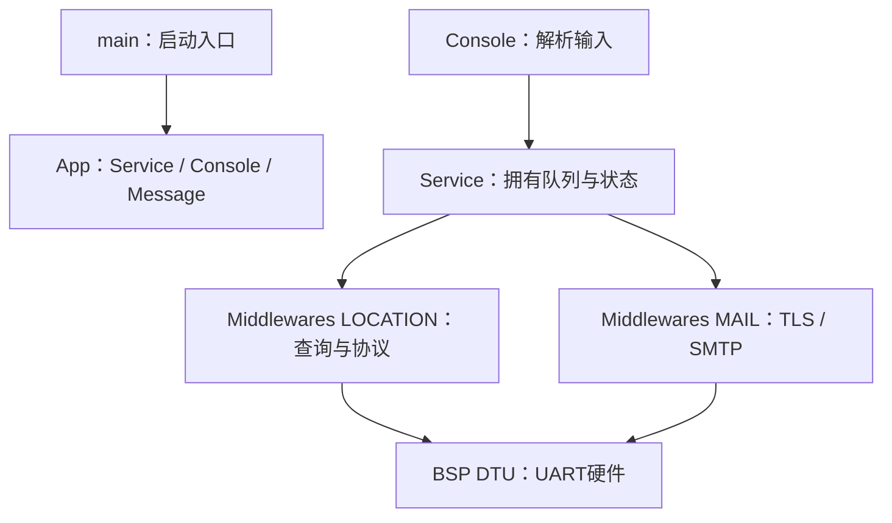

# 工程分层

按用户指定的正点原子basic_routines/20_dht11例程，使用components目录、按模块子目录存放源码和头文件、组件CMake登记SRC_DIRS/INCLUDE_DIRS/REQUIRES。未复制DHT11、LCD等不需要的驱动，也未沿用示例的-ffast-math；坐标NaN/范围校验必须保持正常浮点语义。

```text
sample_project/
├─ main/
│  ├─ main.c                       # 仅启动服务和控制台
│  └─ CMakeLists.txt
├─ components/
│  ├─ BSP/
│  │  ├─ DTU/
│  │  │  ├─ dtu_uart.c/.h          # UART1配置、收发、清缓存、错误检查
│  │  │  └─ dtu_frame.c/.h         # 纯C字节校验，禁止NUL截断
│  │  ├─ Kconfig.projbuild         # 板级TX/RX配置，原配置名保留
│  │  └─ CMakeLists.txt
│  ├─ Middlewares/
│  │  ├─ MAIL/
│  │  │  ├─ mail_link.c/.h         # TLS、MIME、SMTP连接
│  │  │  └─ mail_protocol.c/.h     # 纯C SMTP协议与应答
│  │  ├─ LOCATION/
│  │  │  ├─ location_query.c/.h    # DTU查询、超时与失败清理
│  │  │  └─ location_protocol.c/.h # 纯C应答校验
│  │  └─ CMakeLists.txt
│  └─ App/
│     ├─ Service/
│     │  ├─ app_service.c/.h       # 唯一worker、队列、凭据与互斥状态
│     │  ├─ mail_service.h         # 原邮件业务接口
│     │  └─ location_service.h     # 原定位业务接口
│     ├─ Console/app_console.c/.h # 命令解析、隐藏输入、结果显示
│     ├─ Message/location_mail.c/.h # 定位邮件正文组合
│     └─ CMakeLists.txt
├─ tests/                         # 宿主回归测试
├─ scripts/                       # 构建、测试、配置助手
└─ history/20261011-before-layer-refactor/ # 完整旧main源码和旧测试脚本
```

## 依赖关系



BSP不引用邮件或定位模块，不拥有邮箱凭据。Middlewares不引用App，不处理命令行或业务队列。App的Service是DTU唯一串口操作调度者；Console只能通过服务接口访问状态，不能直接操作DTU UART或凭据全局变量。Console使用ESP-IDF自带UART0 REPL，不等于直接访问UART1业务驱动。

UART1仍在用户确认接线后由mail_wiring_ok启用；主程序不在启动时自动开业务串口，不自动发邮件。控制台命令、业务接口、TLS校验、定位失败处理、未知结果不重发行为保留。mail_link_init/mail_link_location保留兼容入口，分别委托BSP和LOCATION，业务代码直接使用独立定位模块。

## 使用与验证

独立启动扩展：App/Boot负责加载私有编译配置，Middlewares/TIME负责DTU网络时间读取和UTC转换。自动启动流程仍由App/Service的唯一worker执行，不新增并发UART任务；见README_独立上电邮件.md。

接线和邮件配置见README_邮件链路.md，定位见README_定位链路.md，组合邮件见README_定位邮件联动.md。编译仍用scripts/build.ps1，回归仍用scripts/test.ps1；测试脚本已更新到新的组件路径。

重构不修复设备端LBS双零，不改变DTU平台参数，不代表ESP32上板测试已通过。一键迁移脚本scripts/refactor_layers.py仅记录本次迁移过程，检测到备份目录后会拒绝重复执行，不属于设备产品运行代码。
