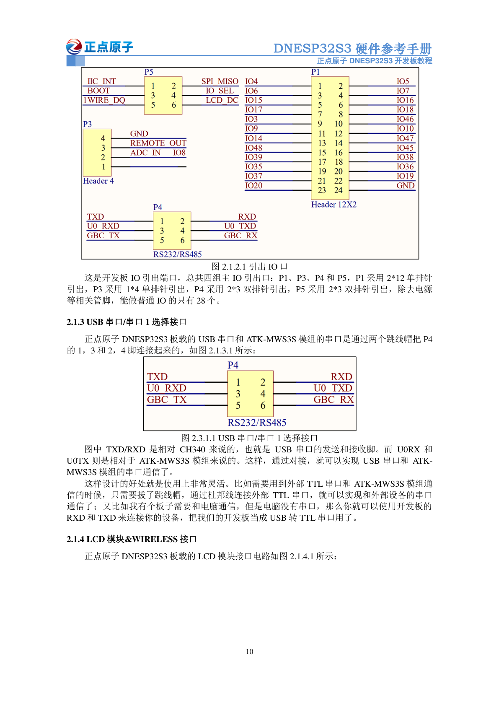

# ESP32-S3 + M100MG 邮件发送链路

本工程使用 ESP-IDF 5.1.2 / ESP32-S3，参考 DNESP32S3 V1.0 硬件手册。
ESP32生成邮件、执行SMTP认证及TLS；4G模块只做TCP透传到腾讯现有的 `smtp.qq.com:465`。
不使用Wi-Fi、不建立PPP、不需要自建服务器。电脑辅助脚本仅通过USB_UART设置RAM参数和时间，**不在电脑上发送SMTP邮件**。

当前交付是可编译的独立邮件原型，包含测试发信与通用UTF-8文本发信API。
用户确认尚未接线、没有LCD。因此**没有烧录，没有ESP32实机TLS/发信/实收证据**。
前一轮电脑通过4G收到邮件的结果不能作为本固件的硬件验收。

## 1. 接线（接好后再启用业务串口）

| DNESP32S3 | 连接 | 依据 |
|---|---|---|
| P1 第1脚 / GPIO4 / UART1 TX | DTU 的 TTL RX | 手册物理第14页图2.1.2.1；GPIO复用分配物理第11页 |
| P1 第2脚 / GPIO5 / UART1 RX | DTU 的 TTL TX，须为3.3V电平或经转换 | 同上 |
| P1 第24脚 / GND | DTU GND | 同图 |
| USB_UART Type-C | 电脑，负责下载与UART0调试台 | 手册物理第22页，板载CH340C |

GPIO4/5与RGB LCD、摄像头的数据线复用，本原型不连接RGB屏和板载摄像头；并非“完全空闲引脚”。
P1编号按手册图和实物丝印核对，不凭插座方向猜测。
手册注明GPIO35/36/37“勿用”，不使用它们。
UART1默认115200、8N1、不用RTS/CTS。UART0日志不会混入UART1的TLS数据。

DTU保持原独立供电，按实际型号对应厂商要求供电。ESP32的3.3V/5V输出不作为本次4G电源。
DTU RX/TX仅连接TTL接口，不接RS232/RS485。确认DTU TX到ESP32的电平不超过3.3V；若为5V需转换。
原USB转串口助手与DTU的TX/RX连接应断开，避免两个控制器同时驱动输入。
平台显示C2、用户称B2的型号差异仍未解决；本程序不推断模块供电、电平或定位功能。



## 2. DTU参数

沿用之前电脑已实测的参数版本5，固件 `YED_DTU4_2.0.3`：

- 通道1：启用，TCP客户端，绑定UART，`smtp.qq.com` / `465`。
- 模块SSL关闭，ESP32的mbedTLS负责端到端加密与证书校验。
- 心跳、登录注册包、前后缀、IPv6均关闭；通道2～4、自动任务、GNSS自动上报关闭。
- UART115200 8N1；串口组帧超时保持之前的80ms。

程序不会重写上述参数，会在每次探测/发信前发送 `config,set,reboot`，等待20秒建立新TCP连接，
再读取 `config,get,netchaninfo,1` 检查通道1。20秒不是所有网络环境的联网保证；未联网时TLS会限时失败。
该重启行为用于独立邮件原型，不能直接用于正在承载导航/AI业务的整机通道。
回到MQTT前需恢复之前参数备份；不要将含敏感字段的备份公开。

## 3. 编译、烧录

本机环境是 `D:/esp32-idf/Espressif/frameworks/esp-idf-v5.1.2`，工具目录 `D:/esp32-idf/Espressif`。
脚本在当前进程导出官方工具环境，不修改系统持久PATH。只依赖IDF内置组件，没有ADF/SR或第三方固件插件。
保留原16MB Flash分区表，factory应用分区0x1f0000；其余存储分区不挂载、不保存授权码；不含OTA。

```powershell
cd C:\Users\workspace\Desktop\sample_project
.\scripts\build.ps1
```

烧录在已配置的ESP-IDF终端执行，`COM_ESP32`替换为开发板实际端口：

```powershell
idf.py -p COM_ESP32 flash
```

不要把4G模块的COM9当作ESP32端口。旧VS Code设置COM8仅是历史值，未在本轮验证。
本轮没有执行flash或erase_flash，不覆盖开发板已有程序。
`build/main.bin`仅是应用镜像；首次下载请使用idf.py flash同时写入对应bootloader及分区表。

## 4. 先探测，再发送

普通系统Python需要pyserial（本机已安装）。关闭ESP-IDF monitor/串口助手，释放开发板USB_UART端口。
下面的脚本在本地终端输入邮箱和SMTP授权码，授权码隐藏，不写命令行、配置文件或日志。
授权码只保存ESP32 RAM；复位/断电丢失。发件邮箱需开启QQ SMTP服务，使用授权码，不是QQ登录密码。

先完成接线和电平核验，只探测TLS与SMTP，不发送邮件：

```powershell
python .\scripts\configure_mail.py --port COM_ESP32 --probe
```

预期成功结果 `PROBE_OK`，意味着证书校验、SMTP欢迎及EHLO通过，不代表发送过邮件。
每次运行都会把电脑当前UTC时间送入ESP32，启用证书有效期检查；先确保电脑时钟准确。
默认ESP-IDF配置原本未启用证书有效期检查，本工程已启用，未校时不能请求发送。

发送一封中文测试邮件：

```powershell
python .\scripts\configure_mail.py --port COM_ESP32 --send
```

题目 `ESP32-S3 4G 邮件通道测试`，正文明确“并非真实求助”。邮箱和授权码在本机交互输入，勿发到聊天。
不加 `--probe` / `--send` 时只设置RAM凭据及时间，不发信。
电脑完成配置后可以断开调试连接，ESP32的发送与TLS由自身执行；但重启后仍需重新设置时间和凭据。
当前没有可信RTC/GNSS校时、凭据持久化或无人值守断电恢复方案，整机集成需补这些部分。

| 结果 | 含义及处理 |
|---|---|
| `PROBE_OK` | TLS和EHLO探测通过；没有AUTH、没有邮件 |
| `DATA_ACCEPTED` | QQ服务器对完整DATA返回250；再核对收件箱/垃圾箱确认实收 |
| `REJECTED` | SMTP明确拒绝，如认证或收件地址失败 |
| `FAILED` | 握手、配置或DATA前通信失败；看最后的安全阶段日志 |
| `UNKNOWN_NO_RETRY` | DATA开始后通信断开或无法解析最终答复，可能已投递；先查收件箱，不自动重发 |

成功DATA后QUIT失败不会改写接受结果。所有失败均不自动发送第二封。
日志只记录阶段、TLS版本、错误数值与结果，不输出授权码、邮箱、正文或原始SMTP响应。

清除RAM授权码：

```powershell
python .\scripts\configure_mail.py --port COM_ESP32 --clear
```

手动调试台支持 `help`、`mail_status`、`mail_time UNIX秒`、`mail_wiring_ok`、`mail_setup`、
`mail_probe`、`mail_send_test`、`mail_clear`。`mail_setup`的三个输入不回显；不要把授权码拼进命令行。

## 5. 程序结构与整机接口

| 文件 | 职责 |
|---|---|
| `main/main.c` | FreeRTOS单工作任务、单请求队列、RAM配置、ESP-IDF调试台 |
| `main/mail_link.c` | UART驱动、DTU检查/重启、mbedTLS串口BIO、证书/主机名/有效期、MIME生成 |
| `main/mail_protocol.c` | 有界SMTP状态流程、碎片/多行回复处理、地址与参数校验 |
| `main/mail_service.h` | 应用层异步发送入口 |
| `scripts/configure_mail.py` | 电脑串口配置/校时/手动探测与发送，不建立SMTP网络连接 |
| `tests/` | 运行实际C协议代码的宿主测试，以及辅助脚本测试 |

整机普通任务可调用：

```c
#include "mail_service.h"
esp_err_t err = mail_request_text("比赛演示：模拟求助", "这是一次手持模拟事件，请按演示流程处理。");
```

`ESP_OK`只表示请求已排队，不表示邮件已发出。单任务独占UART1，发送期间新请求返回 `ESP_ERR_INVALID_STATE`。
主题最多45个UTF-8字节，正文最多768个UTF-8字节（不是汉字个数），超长拒绝，不截断。
主题RFC2047 Base64、正文MIME Base64，并以76列换行，避免中文乱码或SMTP点号结束注入。
该例只演示API，不已接入跌倒、15秒取消、GNSS、导航、MaixCAM2或音频。

本原型没有Wi-Fi或ADC任务。由于RF未启用，TLS期间启用IDF内部ADC熵源，清理后关闭。
整机接入ADC/Wi-Fi前必须协调熵源拥有权，不能与其他ADC/RF使用并行。
目前每次操作都重启DTU，尚未实现多业务通道调度、持久化事件去重、无人值守恢复或结果回调。

## 6. 复核与证据

宿主测试使用Python ziglang包提供的Zig C编译器（本机0.16.0）及pyserial：

```powershell
python -m pip install ziglang pyserial
.\scripts\test.ps1
```

测试验证实际 `mail_protocol.c`，包括逐字节响应、SMTP多行、畸形/截断响应、地址和AUTH注入、
DTU配置、DATA接受/拒绝/未知，以及电脑助手的端口控制线、输入校验与脱敏超时。
具体执行记录在 `verification/`。单元测试不模拟为真实蜂窝网络或硬件测试。

ESP-IDF官方参考：
[UART驱动](https://docs.espressif.com/projects/esp-idf/en/v5.1.2/esp32s3/api-reference/peripherals/uart.html)、
[证书包](https://docs.espressif.com/projects/esp-idf/en/v5.1.2/esp32s3/api-reference/protocols/esp_crt_bundle.html)。
API同时对照本机IDF/mbedTLS头文件核验；不依赖新版本API猜测。
