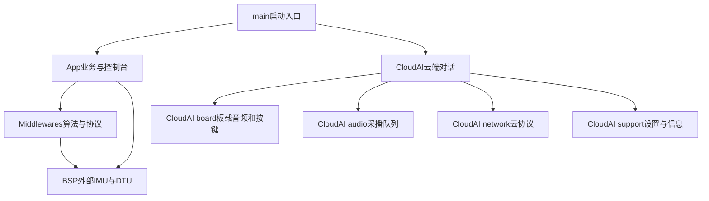

# 当前工程分层

2026-10-14随后新增视觉与前台调度：BSP/Vision管理UART2，Middlewares/Vision实现协议和互斥状态机，App/Vision拥有请求/状态/日志。CloudAI三键通过App提交意图，main注册云端控制/停止确认回调，App不依赖CloudAI，避免循环依赖。摔倒和原DTU邮件文件保持原样。见[视觉与前台模式](../guides/视觉与前台模式.md)。下方“保持原行为”描述的是此前目录整理阶段。

整理日期：2026-10-14。此次按职责移动文件、更新构建清单与引用；现有按键规则、音频队列、任务优先级/栈、摔倒算法、邮件处理和硬件配置保持原行为。

## 目录与职责

```text
sample_project/
├─ main/                         仅启动各服务
├─ components/
│  ├─ App/
│  │  ├─ Boot/                   编译配置、检测参数映射、启动校准
│  │  ├─ Service/                持续采样、事件队列、唯一DTU worker
│  │  ├─ Console/                UART0控制台与命令
│  │  └─ Message/                定位/求助正文与原重试规则
│  ├─ BSP/
│  │  ├─ DTU/                    UART1收发与字节校验
│  │  ├─ MPU6050/                寄存器驱动、采样、公共传感器类型
│  │  └─ I2C/idf5/               集成版新I2C驱动适配
│  ├─ Middlewares/
│  │  ├─ FALL/                   纯C姿态、校准、摔倒状态机
│  │  ├─ LOCATION/               LBS/GNSS查询及应答解析
│  │  ├─ TIME/                   DTU时间查询与UTC转换
│  │  └─ MAIL/                   SMTP/MIME、TLS及协议校验
│  └─ CloudAI/
│     ├─ control/                云端入口、会话状态与KEY0事件规则
│     ├─ board/                  DNESP32S3 I2C、KEY0、ES8388与Wi-Fi启动
│     ├─ audio/                  采播队列、Opus编解码、音频处理器
│     ├─ network/                服务发现/激活、MQTT/UDP与WebSocket协议
│     └─ support/                NVS设置、设备信息、语言字符串
├─ managed_components/           5个固定音频/网络依赖
├─ scripts/                      日常构建、回归、串口配置助手
│  ├─ docs/                      历史图示生成工具
│  └─ history/                   一次性迁移/工具链恢复脚本
├─ tests/                        宿主回归与驱动桩
├─ docs/                         全部项目说明、图示与人可读报告
├─ verification/                 原始日志、JSON、哈希与测试缓存
├─ history/                      历史代码快照
└─ private/                      本地私有配置，禁止公开
```

每个组件的 `CMakeLists.txt` 显式列出生产源码，新增文件需主动登记。根CMake只编译 `main` 的依赖，并将 `CLOUD_AI_BUILD` 同步为早期依赖展开使用的环境开关；不再依赖外部终端碰巧保存的状态。

## 依赖与所有权



- `App/Service/fall_app.c` 独占检测状态，在core1持续采样；事件仅投递给邮件worker，不等待网络。
- `App/Service/app_service.c` 是DTU UART1唯一业务调度者，串行执行时间、定位和邮件事务。
- `Middlewares/FALL` 只处理传感器数据与时间，不访问I2C、UART、按键、邮箱或云端会话。
- `CloudAI/control/cloud_ai.cc` 提供main调用入口；`application.cc` 管理云端会话，`conversation_gate.h` 防止过期会话操作。
- `CloudAI/board/key0_driver.cc` 读取XL9555，事件规则在 `control/key0_filter.h`。按键仅请求云端开启或退出。
- `CloudAI/board/es8388_audio_codec.*` 提供板载Codec；通用Codec接口及采播队列在 `audio/`。
- `CloudAI/network/cloud_bootstrap.*` 复用小智ota发现接口取得服务配置与激活信息，不执行固件升级。原 `Ota` 类更名为 `CloudBootstrap`。
- 第三方Opus、Wi-Fi、网络和Codec库不改动，不引入屏幕或摄像头模块。

板级云端适配保留在CloudAI组件内部，以免把外部IMU/DTU与云端音频的类型相互耦合。通用算法继续独立，两个业务不会互相启动/停止。

## 阅读顺序

1. [main入口](../../main/main.c)：服务启动顺序。
2. [云端入口](../../components/CloudAI/control/cloud_ai.cc)和[会话控制](../../components/CloudAI/control/application.cc)：KEY0请求如何变成会话操作。
3. [板级适配](../../components/CloudAI/board/board.cc)、[按键驱动](../../components/CloudAI/board/key0_driver.cc)：真实外设初始化与读键。
4. [音频服务](../../components/CloudAI/audio/audio_service.cc)：麦克风、编码、发送、解码和播放队列。
5. [持续检测任务](../../components/App/Service/fall_app.c)和[DTU服务](../../components/App/Service/app_service.c)：检测与求助邮件的独立链路。

## 构建配置

| 入口 | IDF / 输出目录 | 说明 |
|---|---|---|
| `scripts/build-cloud.ps1` | 5.4 / `build-cloud` | 当前云端对话＋持续检测＋4G邮件集成版 |
| `scripts/build.ps1` | 5.1.2 / `build` | 原邮件/摔倒配置，无云端语音 |
| `scripts/test.ps1` | 宿主 / `verification` | 按键、协议、检测、驱动及辅助脚本回归 |

新I2C适配在 `BSP/I2C/idf5`；原5.1的I2C文件继续位于 `BSP/MPU6050`，保护旧源码和旧构建。两套构建共用原MPU6050寄存器驱动与检测算法。

详细操作见[云端对话指南](../guides/KEY0云端对话.md)，实机证据见[上机记录](../verification/hardware_cloud_20261014/上机验证记录.md)。整理后的构建检查不能替代再次烧录测试；板上仍运行先前通过验证的固件。
