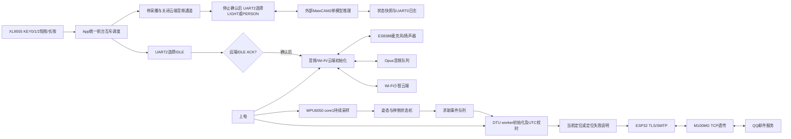

# 系统工作原理

当前集成版包含云端语音与外部MaixCAM2视觉两个互斥前台，以及持续独立运行的MPU6050检测和DTU 4G定位求助邮件。ESP32板载屏幕和摄像头不参与工程；外部视觉UART2接线未定，默认禁用。

KEY0短按选择云端对话，KEY1选择红绿灯，KEY2选择行人方位；长按约2秒退出对应当前/待选业务。进入新业务前必须确认旧业务停止，未确认远端IDLE时不启动对话。UART禁用时视觉不启动，KEY0仍可用。BOOT不承担这些功能。检测从启动开始持续运行，不参与前台互斥。

检测事件进入队列，原邮件worker串行查询定位并发信。检测任务不等待TLS；云端语音通过Wi-Fi联网，不借用DTU UART1。邮件成功依据SMTP最终应答，`DATA_ACCEPTED`再结合邮箱实收确认闭环。

| 外设 | 当前配置 |
|---|---|
| 板载XL9555/ES8388 | I2C0，GPIO41/42 |
| 外接MPU6050 | I2C1，GPIO4/5，0x68，125Hz采样 |
| DTU | UART1，TX17/RX18，115200 8N1 |
| KEY0 | XL9555 P1_7，低有效 |
| KEY1 / KEY2 | XL9555 P1_6 / P1_5，低有效 |
| 外部视觉 | UART2，115200 8N1，TX6/RX16，禁用，接线待确认；IO7保留IMU INT |
| Flash/PSRAM | 16MB Flash、8MB Octal PSRAM，保留原分区 |

2026-10-14此前固件的实机日志及用户反馈已确认KEY0启停、多轮对话和对话期间模拟摔倒邮件实收；新增三键互斥及视觉串口尚未烧录或双板联调。长期稳定性、断网完整恢复、偶发I2C NACK和UDP丢包仍需继续观察，不能据手持演示推定真人跌倒检测性能。

详见[代码结构](工程分层.md)和[实机记录](../verification/hardware_cloud_20261014/上机验证记录.md)。2026-10-12单邮件版本的图示及说明保存在[历史说明](../history/20261012-mail/系统框图与工作原理.md)。
