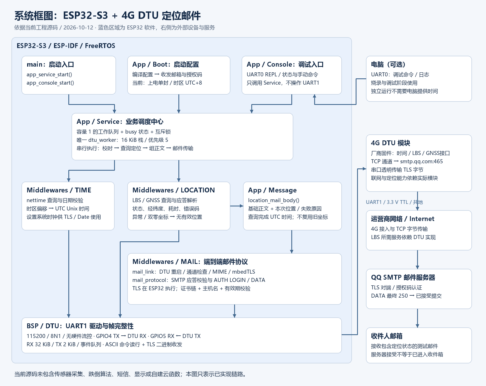
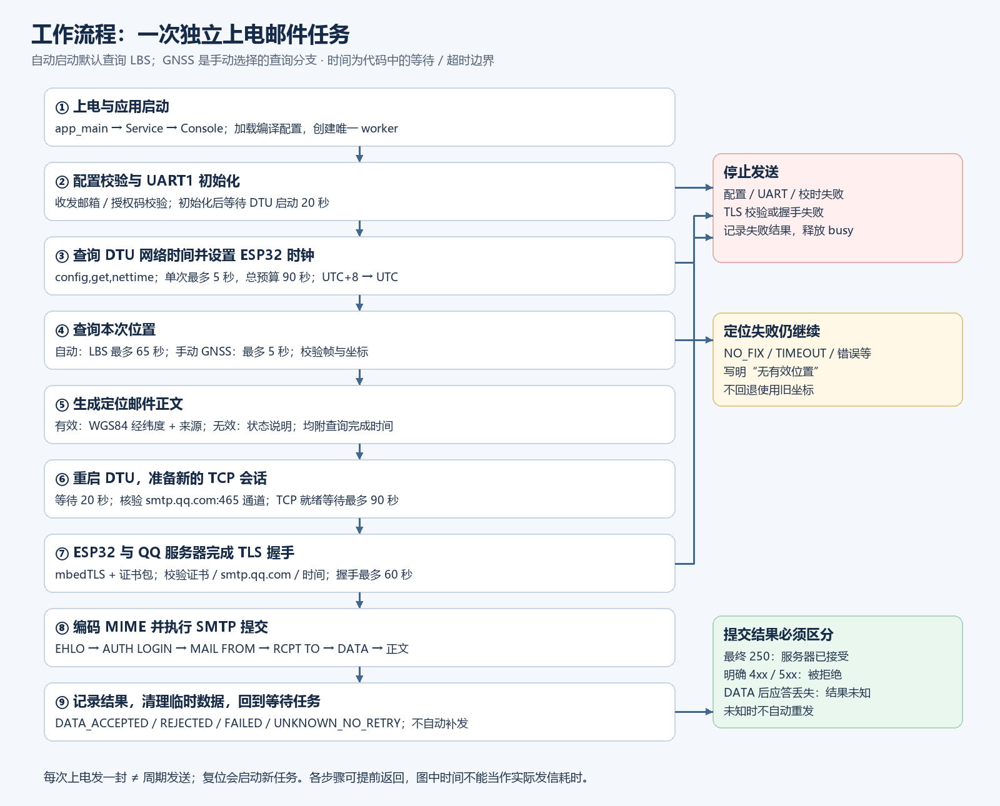

# 当前工程系统框图与工作原理

依据 2026-10-12 当前 main、components 和 sdkconfig 整理。本文描述源码行为；没有在本次分析中重新烧录或进行硬件实测。

## 1. 系统目标与边界

当前工程是 ESP32-S3 + 4G DTU 的独立上电定位邮件演示：ESP32 加载邮件配置，从 DTU 获取时间和位置，生成正文，通过 DTU 的 TCP 透传连接 QQ SMTP 服务器，提交一封测试邮件。

当前本机启动开关 MAIL_BOOT_ENABLE=1，时间偏移为 +480 分钟。没有私有配置时，CMake 选择 Boot/Defaults 的禁用模板。邮箱和授权码没有写入本文或框图。

当前组件没有传感器采集、跌倒识别、短信发送、显示或摄像头逻辑。邮件链路直接连接 QQ SMTP，不经过自建云函数。LBS/GNSS 解析接口存在，不代表实际模块已获得可靠位置。工程 README 记录过独立上电实收邮件，但本次没有重新验证该硬件结果。

## 2. 系统框图



[SVG 矢量图](system_architecture.svg)可用于放大、排版或插入报告；PNG 用于直接浏览。

读图时，左侧表示 ESP32 内部的软件职责，右侧表示电脑、DTU、运营商网络和邮件服务。箭头表示主要调用或数据去向；UART/TCP/TLS 实际包含双向收发。TIME 到 BSP 的箭头表示查询串口，设置 ESP32 时钟则由 Service 完成。

## 3. 硬件与通信关系

| 部分 | 当前角色 | 接口或配置 |
|---|---|---|
| ESP32-S3 | 业务调度、解析、正文构造、TLS 与 SMTP | ESP-IDF / FreeRTOS |
| ESP32 UART1 | 与 DTU 交换命令及 TLS 二进制字节 | 115200、8N1、无硬件流控 |
| GPIO4 | ESP32 发送端 | 接 DTU RX |
| GPIO5 | ESP32 接收端 | 接 DTU TX |
| GND | 串口电平参考 | ESP32 与 DTU 共地，3.3V TTL |
| DTU | 网络时间、定位查询接口、4G 接入、TCP 透传 | 预先配置到 smtp.qq.com:465 |
| UART0 控制台 | 手动调试、配置和状态查询 | 115200；独立运行无需电脑输入 |
| QQ SMTP | TLS 对端、用户认证、接受邮件提交 | 隐式 TLS 端口 465 |
| 收件邮箱 | 最终接收邮件 | 实际收件应独立确认 |

DTU 的 TCP 通道需要提前配置。代码的 prepare_dtu() 会读取并验证目标和透传参数，没有自动把任意 DTU 配成正确 SMTP 通道。

接线图不能替代供电设计。ESP32 与 DTU 各自按板卡要求供电；UART 线不负责给另一块设备供电。

## 4. 软件分层与任务模型

| 层 | 文件 | 主要职责 |
|---|---|---|
| 启动 | main/main.c | 启动应用服务和控制台 |
| App / Boot | boot_config.c | 从编译配置取得启动开关、时区和邮件凭据 |
| App / Service | app_service.c | 拥有凭据、队列、互斥锁、busy 和结果状态 |
| App / Console | app_console.c | 解析调试命令，经服务接口提交操作 |
| App / Message | location_mail.c | 将定位结果转换为邮件正文 |
| Middlewares / TIME | dtu_time_query.c、dtu_time_parse.c | 查询时间、检查日期、换算 UTC |
| Middlewares / LOCATION | location_query.c、location_protocol.c | 查询位置、处理超时、验证返回数据 |
| Middlewares / MAIL | mail_link.c、mail_protocol.c | TLS、MIME、SMTP 以及提交结果判断 |
| BSP / DTU | dtu_uart.c、dtu_frame.c | UART 初始化、收发、完整性与字符帧检查 |

Service 创建容量为 1 的工作队列、状态互斥锁，以及一个名为 dtu_worker 的 FreeRTOS 任务，其栈为 16384 字节，优先级为 5。Console 有自己的 REPL 执行环境，但业务 UART1 的查询和传输集中在 worker 串行执行。

这是本工程并发控制的核心：任务忙时，新的邮件、定位或校时请求返回状态错误，避免命令应答与 TLS 数据混到同一串口流中。队列容量为 1 不意味着可以积压很多邮件；busy 会限制新的业务请求。

自动启动工作与手动命令共用服务。自动模式启动时入队一项 autonomous 工作；关闭自动启动后，用户可以通过控制台确认接线、配置时间和邮件参数，再提交操作。

## 5. 上电流程图与逐步解释



[SVG 矢量流程图](boot_mail_flow.svg)。

### ① 启动服务并加载配置

app_main() 先调用 app_service_start()，再启动 app_console_start()。

Service 加载编译配置，并验证收发邮箱、发件域及授权码格式。自动模式创建一项包含 attach_location=true、source=LOCATION_LBS 的任务。因此上电默认进行 LBS 定位后发信；GNSS 需要手动选择。

### ② 初始化 UART，等待 DTU

worker 初始化 UART1，配置 GPIO4/5，然后等待 20 秒给 DTU 留出启动时间。驱动配置接收缓冲区 32768 字节、发送缓冲区 2048 字节和 64 项 UART 事件队列。

驱动会检查溢出、缓冲区满、校验和帧错误。命令应答需要完整 CRLF；嵌入 NUL 等非法字节不能被当作正常字符串提前截断。TLS 的二进制接收走独立字节接口，不套用 ASCII 字符过滤。

### ③ 从 DTU 获取时间

发送厂商命令：

```text
config,get,nettime\r\n
```

单次读取预算为 5 秒；Service 在总计 90 秒的校时预算内再次尝试，失败间隔最多 2 秒。

解析器检查帧、字段、2025—2100 年范围、月份、日期、闰年和时分秒。当前偏移 +480 分钟，因此把模块报告的北京时间减去 8 小时，得到 UTC Unix 时间，随后调用 settimeofday() 设置 ESP32 系统时钟。

时钟供 TLS 证书有效期验证、邮件 Date 和正文查询完成时间使用。时间无效时停止发信。DTU 时间通过模块接口取得，代码没有为该来源提供独立的加密认证。

### ④ 获取本次位置

| 来源 | 查询命令 | 查询预算 | 解释 |
|---|---|---|---|
| LBS | config,get,lbsloc | 65 秒 | 模块提供的基站估算位置 |
| GNSS | config,get,gpsext | 5 秒 | 读取模块当前报告，不是启动完整搜星流程 |

LBS 解析经度和纬度；GNSS 还检查有效标志、东西经、南北纬等字段。经度须在 ±180° 内、纬度须在 ±90° 内，且必须是有限数值。双零坐标被当作模块无位置标记。

返回 location_result_t：来源、状态、经纬度、查询耗时、错误码。状态分为 VALID、NO_FIX、BAD_REPLY、DEVICE_ERROR、TIMEOUT、IO_ERROR。无效结果会清除坐标。

源码按 WGS84 输出，但实际精度、模块所报位置的新鲜程度以及坐标系正确性还需硬件核验。

### ⑤ location_mail.c 把定位结果转成正文

当前打开的 location_mail.c 位于业务消息层。它不负责获取定位、不控制串口、不连接邮件服务器；它负责把数据转换成可以发给人的文字。

输入为基础正文、location_result_t、查询完成 Unix 时间和输出缓冲区。输出内容包括：

- 基础测试说明；
- LBS 或 GNSS 来源；
- 有效时的 WGS84 经纬度及精度提示，或无效时的状态说明；
- 本次查询完成 UTC 时间；
- “查询时间不代表定位数据产生时间”的说明。

它再次检查坐标和输出容量，正文最多 768 字节，基础正文最多 400 字节；这些是字节限制，不是汉字数量。定位失败一般仍可形成正文并继续发信；正文参数或容量检查失败则不提交邮件。

邮件组合任务直接查询本次位置，没有从 location_get_last() 取缓存坐标。位置已经写入正文后，临时结构被清除；之后 DTU 即使重启，正文内容仍保留在任务消息中。

### ⑥ 建立干净的 TCP 会话

mail_link_run() 首先发送 config,set,reboot，等待 DTU 重启 20 秒，清理输入缓存，读取 netchaninfo 通道配置并验证 smtp.qq.com:465。接着通过 netstatus 查询 TCP 是否已经连接，等待预算为 90 秒。

重启用于丢弃上一会话，尤其是失败或结果不确定的 SMTP DATA 状态。仅“通道参数正确”不能证明“TCP 已经连上”，所以这两项检查分开进行。

### ⑦ TLS 加密在 ESP32 执行

mail_link.c 创建 mbedTLS 客户端，使用证书包、强制验证服务器证书，并设置 smtp.qq.com 主机名；最低 TLS 版本为 1.2，握手预算为 60 秒。

底层 BIO 发送、接收回调接入 dtu_uart_write/read。由此形成：

```text
ESP32：SMTP 明文 → TLS 加密 → UART 字节
DTU：UART 字节 ↔ TCP 字节 ↔ 4G 网络
QQ：TLS 解密 → SMTP 处理
```

因此 DTU 负责传输加密字节，SMTP 会话和 TLS 状态位于 ESP32。Base64 仅用于 MIME 和 AUTH LOGIN 编码；传输保密来自 TLS。

### ⑧ 构造 MIME，进行 SMTP 提交

MIME 包含 From、To、UTF-8 主题、Date、Message-ID、内容类型和 Base64 正文。中文主题和正文通过编码传输。

| 阶段 | 发送或接收 | 正常应答 |
|---|---|---|
| 服务器问候 | 接收 greeting | 220 |
| 能力协商 | EHLO | 250 |
| 登录开始 | AUTH LOGIN | 334 |
| 用户名 | Base64 发件邮箱 | 334 |
| 授权码 | Base64 SMTP 授权码 | 235 |
| 发件信封 | MAIL FROM | 250 |
| 收件信封 | RCPT TO | 250 或 251 |
| 开始正文 | DATA | 354 |
| 提交正文 | MIME + 结束标记 | 最终 250 |

SMTP 会话总预算为 120 秒，各阶段设置不超过剩余总预算的 30 秒期限。得到最终 DATA 250 后记录 DATA_ACCEPTED，并尝试 QUIT。

### ⑨ 记录结果并等待下一任务

| 对外结果 | 意义 |
|---|---|
| FAILED | 配置、校时、连接、TLS 或提交前协议步骤失败等 |
| REJECTED | 收到服务器明确的失败应答 |
| UNKNOWN_NO_RETRY | DATA 传输或最终应答无法确认，可能已经收到 |
| DATA_ACCEPTED | 服务器已接受本次邮件提交 |
| PROBE_OK | TLS 和 EHLO 探测成功，没有登录发信 |

结果未知时不自动重发，避免把“应答丢失”当成“未提交”造成重复。临时凭据副本、MIME、任务内容等清零，busy 解除，worker 回到队列等待。服务中的有效运行凭据仍供后续手动请求使用。

“每次上电一封”是每次启动触发一次工作，不是定时循环；设备复位或再次上电会启动新任务。当前没有持久化事件去重。

## 6. 手动调试如何进入同一链路

| 命令 | 用途 |
|---|---|
| mail_status | 查看配置、时钟、busy、结果和堆状态 |
| mail_wiring_ok | 手动确认接线并启用 UART1 |
| dtu_time_sync | 由 worker 查询 DTU 时间 |
| mail_time UTC秒数 | 手动设置当前 UTC 时间 |
| mail_setup | 输入收发邮箱和隐藏授权码，存于运行 RAM |
| mail_clear | 清除 RAM 凭据 |
| location_get lbs / gnss | 单独查询位置 |
| location_get lbs show | 查询并在本地打印有效坐标 |
| location_status | 显示上次独立查询状态和查询年龄，不打印坐标 |
| mail_probe | 重启 DTU，验证 TLS 和 EHLO，不发邮件 |
| mail_send_test | 单封普通测试邮件 |
| mail_send_location lbs / gnss | 查询本次位置并发送单封邮件 |

独立查询的缓存结果和“定位邮件任务”是不同用途。发送邮件会使之前独立查询缓存失效，因为邮件过程会重启 DTU；定位邮件自身不会把其坐标发布成长期有效缓存。

mail_clear 仅清运行 RAM；重新上电仍会重新加载编译凭据。当前配置持久性来自编译进固件，而非加密 NVS。

## 7. 阅读代码时应注意的现状

1. 以当前源码和配置为准。README_工程分层.md 的早期段落和 Console 启动提示还写着“不自动发送 / UART1 初始禁用”，与本机启用的自动上电流程不一致。
2. 收到邮件只证明本次投递到达，不证明位置有效或 GNSS 精度。
3. DATA_ACCEPTED 表示提交被服务器接受；最终是否进入收件箱由邮件服务处理。
4. 定位查询时间是查询完成时刻，不是卫星定位解算时刻，也不是位置年龄。
5. 本次仅新增图和说明，没有修改固件源码或重新进行板上测试。

## 8. 图形复用

- system_architecture.png / .svg：详细系统框图。
- boot_mail_flow.png / .svg：上电任务流程图。
- generate_system_diagrams.py：使用 Pillow 和 Windows 微软雅黑生成两幅图片及 SVG。
- 重新生成：在工程根目录执行 python docs/generate_system_diagrams.py。

